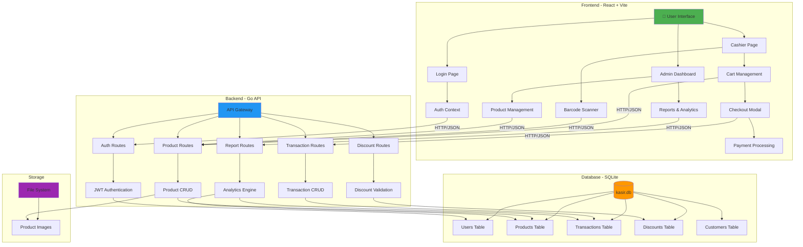

# 🛒 Sistem Kasir - Toko Makanan

Sistem kasir modern dengan fitur lengkap untuk toko retail/makanan. Dibangun dengan React + Vite (Frontend) dan Go (Backend).


## ✨ Fitur Utama

| Fitur | Deskripsi |
|-------|-----------|
| 📷 **Barcode Scanner** | Scan barcode EAN-13, UPC, Code128, QR Code |
| 🔐 **Multi-User Auth** | Login dengan role Admin & Kasir |
| 📦 **Inventory** | Manajemen stok dengan alert stok rendah |
| 💳 **Multi Payment** | Cash, QRIS, Debit, Credit |
| 🏷️ **Diskon/Promo** | Kode promo dengan persentase atau nominal |
| 📊 **Laporan** | Report harian, bulanan, dan best sellers |
| 🖨️ **Cetak Struk** | Format struk thermal printer |

---

## 🏗️ Arsitektur Sistem

Sistem kasir ini dibangun dengan arsitektur client-server yang terpisah, memberikan fleksibilitas dan skalabilitas:



### Alur Kerja Sistem

1. **Login & Authentication**
   - User login melalui frontend
   - Backend memvalidasi kredensial dengan database
   - JWT token digenerate dan disimpan di browser
   - Token digunakan untuk autentikasi request berikutnya

2. **Proses Transaksi Kasir**
   - Scan barcode atau pilih produk manual
   - Produk ditambahkan ke cart
   - Sistem cek stok di database
   - Kasir input jumlah dan terapkan diskon
   - Checkout → pilih metode pembayaran
   - Backend catat transaksi & update stok
   - Generate struk digital

3. **Manajemen Inventory (Admin)**
   - Admin tambah/edit/hapus produk
   - Upload gambar produk → disimpan di file system
   - Update stok produk
   - Sistem alert jika stok rendah

4. **Laporan & Analytics**
   - Backend aggregate data transaksi
   - Generate laporan harian/bulanan
   - Analisis produk terlaris
   - Export ke Excel/PDF

---

## 🚀 Cara Menjalankan

### Prasyarat

- **Python 3.9+** - [Download Python](https://python.org)
- **Node.js 18+** - [Download Node.js](https://nodejs.org)
- **Git** (opsional) - [Download Git](https://git-scm.com)

### 1️⃣ Clone / Download Project

```bash
# Jika menggunakan git
git clone <repository-url>
cd program_kasir

# Atau download dan extract ZIP
```

### 2️⃣ Setup Backend (Go)

```bash
# Masuk ke folder backend-go
cd backend-go

# Install dependencies
go mod tidy

# Jalankan server backend
go run ./cmd/server
```

Backend akan berjalan di: **http://localhost:8000**

### 📌 Status Migrasi Backend

Backend aktif sekarang sepenuhnya berada di folder **`backend-go/`**.

- `backend-go/` → backend Go baru
- `backend-go/data/kasir.db` → database SQLite aktif
- `backend-go/uploads/` → aset upload aktif

Lihat detail migrasi, asumsi kompatibilitas, hasil verifikasi, dan langkah cutover di:

- **[`backend-go/MIGRATION_STATUS.md`](backend-go/MIGRATION_STATUS.md)**

### 3️⃣ Setup Frontend (React + Vite)

Buka terminal baru:

```bash
# Masuk ke folder frontend
cd frontend

# Install dependencies
npm install

# Jalankan development server
npm run dev
```

Frontend akan berjalan di: **http://localhost:5173**

### 4️⃣ Buka Aplikasi

Buka browser dan akses: **http://localhost:5173** (development) atau **http://localhost:3456** (Docker)

---

## 🔑 Akun Default

| Role | Username | Password |
|------|----------|----------|
| Admin | `admin` | `admin123` |
| Kasir | `kasir` | `kasir123` |

**Admin** dapat mengakses semua fitur termasuk manajemen produk, stok, diskon, dan laporan.

**Kasir** hanya dapat mengakses kasir dan riwayat transaksi.

---

## 📁 Struktur Project

```
program_kasir/
├── backend-go/             # Go backend replacement
│   ├── cmd/server/         # Entry point
│   ├── data/               # SQLite database aktif
│   ├── internal/           # API, config, db, models, handlers
│   ├── uploads/            # Product images / uploaded assets
│   ├── .env.example        # Template environment variables
│   ├── go.mod              # Go module definition
│   └── Dockerfile          # Container build for backend
│
├── frontend/               # React + Vite Frontend
│   ├── package.json       # Node.js dependencies
│   ├── vite.config.js     # Vite configuration
│   ├── index.html         # HTML entry point
│   └── src/
│       ├── main.jsx       # React entry point
│       ├── App.jsx        # Main app component
│       ├── index.css      # Global styles
│       ├── context/
│       │   ├── AuthContext.jsx  # Auth state management
│       │   └── ThemeContext.jsx # Theme management
│       ├── components/
│       │   ├── Header.jsx
│       │   ├── Cart.jsx
│       │   ├── BarcodeScanner.jsx
│       │   └── CheckoutModal.jsx
│       └── pages/
│           ├── LoginPage.jsx
│           ├── CashierPage.jsx
│           ├── AdminPage.jsx
│           ├── InventoryPage.jsx
│           ├── DiscountsPage.jsx
│           ├── ReportsPage.jsx
│           └── HistoryPage.jsx
│
├── .gitignore             # Git ignore rules
└── README.md              # Dokumentasi ini
```

> 💡 **Demo Data Included**
> Repository ini sudah include `kasir.db` (database dengan sample data) dan `uploads/` (gambar produk dummy) agar bisa langsung dicoba tanpa setup tambahan.

> ⚠️ **File yang TIDAK di-commit ke Git:**
> - `node_modules/` - Dependencies Node.js (install dengan `npm install`)
> - `__pycache__/` - Python cache (auto-generated)
> - `.venv/` - Python virtual environment (buat sendiri)


---

## 🔌 API Endpoints

### Auth
```
POST /api/auth/login     - Login
POST /api/auth/register  - Register (admin only)
GET  /api/auth/me        - Get current user
```

### Products
```
GET    /api/products              - List all products
GET    /api/products/{id}         - Get product by ID
GET    /api/products/barcode/{code} - Get by barcode
POST   /api/products              - Create product
PUT    /api/products/{id}         - Update product
PUT    /api/products/{id}/stock   - Adjust stock
DELETE /api/products/{id}         - Delete product
GET    /api/products/{id}/barcode-image - Get barcode image
```

### Transactions
```
GET  /api/transactions      - List transactions
POST /api/transactions      - Create transaction
GET  /api/transactions/{id} - Get transaction detail
```

### Discounts
```
GET    /api/discounts              - List discounts
POST   /api/discounts              - Create discount
GET    /api/discounts/validate/{code} - Validate promo code
PUT    /api/discounts/{id}         - Update discount
DELETE /api/discounts/{id}         - Delete discount
```

### Reports
```
GET /api/reports/daily       - Daily sales report
GET /api/reports/monthly     - Monthly summary
GET /api/reports/best-sellers - Top selling products
GET /api/reports/summary     - Dashboard summary
```

---

## 📷 Cara Menggunakan Barcode Scanner

1. Klik tombol **"▶️ Mulai Scan"**
2. **Izinkan akses kamera** jika browser meminta
3. Arahkan kamera ke **barcode produk**
4. Scanner akan **otomatis mendeteksi** dan menambahkan ke keranjang
5. Terdengar **suara beep** saat berhasil

**Tips:**
- Pastikan pencahayaan cukup terang
- Jarak kamera 10-20 cm dari barcode
- Barcode harus dalam fokus (tidak blur)

**Input Manual:** Jika scanner tidak terdeteksi, ketik barcode secara manual di input box.

---

## � Docker Deployment (Recommended untuk Production)

Deploy aplikasi dengan Docker untuk kemudahan dan konsistensi. Cocok untuk VPS/Cloud hosting 24/7.

### Prerequisites
- Docker & Docker Compose installed
- Ubuntu 20.04+ / Linux VPS (atau Windows/Mac untuk development)

### Quick Start dengan Docker

```bash
# Clone repository
git clone https://github.com/sdhtele/kasirKyuzu.git
cd kasirKyuzu

# Build dan jalankan dengan docker-compose
docker-compose up -d

# Check status
docker-compose ps

# View logs
docker-compose logs -f
```

Aplikasi akan berjalan di:
- **Frontend:** http://localhost:3456
- **Backend API:** http://localhost:8765

### Docker Commands

```bash
# Stop containers
docker-compose down

# Rebuild setelah update code
docker-compose up -d --build

# Restart services
docker-compose restart

# View logs untuk specific service
docker-compose logs -f backend
docker-compose logs -f frontend
```

---

## 🚀 Deploy ke VPS/Ubuntu (24/7 Hosting)

Tutorial lengkap deploy ke VPS untuk running 24 jam non-stop.

### 1️⃣ Persiapan VPS

```bash
# Update system
sudo apt update && sudo apt upgrade -y

# Install Docker
curl -fsSL https://get.docker.com -o get-docker.sh
sudo sh get-docker.sh

# Install Docker Compose
sudo curl -L "https://github.com/docker/compose/releases/latest/download/docker-compose-$(uname -s)-$(uname -m)" -o /usr/local/bin/docker-compose
sudo chmod +x /usr/local/bin/docker-compose

# Verify installation
docker --version
docker-compose --version
```

### 2️⃣ Clone dan Setup Project

```bash
# Install git (jika belum ada)
sudo apt install git -y

# Clone repository
cd /opt
sudo git clone https://github.com/sdhtele/kasirKyuzu.git
cd kasirKyuzu

# Set permissions
sudo chown -R $USER:$USER .
```

### 3️⃣ Configure untuk Production

Docker sudah dikonfigurasi dengan port yang aman. Jika ingin ubah port, edit `docker-compose.yml`:

```yaml
services:
  frontend:
    ports:
      - "3456:80"  # Port 3456 untuk akses frontend
  backend:
    ports:
      - "8765:8000"  # Port 8765 untuk backend API
```

### 4️⃣ Deploy dengan Docker

```bash
# Build dan start containers
sudo docker-compose up -d --build

# Verify containers running
sudo docker-compose ps

# Check logs
sudo docker-compose logs -f
```

### 5️⃣ Setup Auto-Restart (Optional tapi Recommended)

Docker containers sudah dikonfigurasi dengan `restart: unless-stopped`, jadi akan otomatis restart saat:
- Container crash
- Server reboot
- Error terjadi

Untuk memastikan auto-start saat boot:

```bash
# Enable Docker service
sudo systemctl enable docker

# Docker containers akan auto-start karena restart policy
```

### 6️⃣ Firewall Configuration

```bash
# Allow aplikasi ports
sudo ufw allow 3456/tcp  # Frontend
sudo ufw allow 8765/tcp  # Backend API
sudo ufw allow 80/tcp    # Nginx HTTP (optional jika pakai proxy)

# Enable firewall
sudo ufw enable
sudo ufw status
```

### 7️⃣ Maintenance Commands

```bash
# Update aplikasi (setelah git pull update)
cd /opt/kasirKyuzu
sudo git pull
sudo docker-compose up -d --build

# Backup database
sudo cp backend/kasir.db backend/kasir.db.backup

# View resource usage
sudo docker stats

# Clean up unused images
sudo docker system prune -a
```

---

## 🌐 Setup Nginx Reverse Proxy (HTTP)

Untuk akses via domain/IP dengan nginx:

### 1. Install Nginx

```bash
sudo apt install nginx -y
```

### 2. Create Nginx Config

```bash
sudo nano /etc/nginx/sites-available/kasir
```

Paste konfigurasi berikut (ganti `yourdomain.com` dengan domain/IP Anda):

```nginx
server {
    listen 80;
    server_name yourdomain.com;  # Ganti dengan domain atau IP VPS Anda

    # Frontend (React App)
    location / {
        proxy_pass http://localhost:3456;
        proxy_http_version 1.1;
        proxy_set_header Upgrade $http_upgrade;
        proxy_set_header Connection 'upgrade';
        proxy_set_header Host $host;
        proxy_cache_bypass $http_upgrade;
        proxy_set_header X-Real-IP $remote_addr;
        proxy_set_header X-Forwarded-For $proxy_add_x_forwarded_for;
    }

    # Backend API
    location /api {
        proxy_pass http://localhost:8765;
        proxy_http_version 1.1;
        proxy_set_header Host $host;
        proxy_set_header X-Real-IP $remote_addr;
        proxy_set_header X-Forwarded-For $proxy_add_x_forwarded_for;
    }

    # Static Files (Product Images) - IMPORTANT!
    location /uploads {
        proxy_pass http://localhost:8765/uploads;
        proxy_http_version 1.1;
        proxy_set_header Host $host;
        proxy_set_header X-Real-IP $remote_addr;
        
        # Cache static files
        proxy_cache_valid 200 1d;
        add_header X-Cache-Status $upstream_cache_status;
    }

    # Max upload size untuk upload gambar produk
    client_max_body_size 10M;
}
```

### 3. Enable Config & Reload Nginx

```bash
# Enable site
sudo ln -s /etc/nginx/sites-available/kasir /etc/nginx/sites-enabled/

# Test config
sudo nginx -t

# Reload nginx
sudo systemctl reload nginx
```

### 4. Access Aplikasi

Buka browser: `http://yourdomain.com` atau `http://your-vps-ip`

---

## �🛠️ Development

### Reset Database

Hapus file `backend/kasir.db` dan restart server untuk reset database dengan data awal.

```bash
# Windows
del backend\kasir.db

# Linux/Mac
rm backend/kasir.db

# Docker
sudo docker-compose down
sudo rm backend/kasir.db
sudo docker-compose up -d
```

### Build Production

```bash
# Frontend
cd frontend
npm run build

# Output di folder: frontend/dist/
```

---

## 📝 Tech Stack

| Layer | Technology |
|-------|------------|
| Frontend | React 18, Vite, html5-qrcode |
| Backend | Python 3.9+, FastAPI, SQLAlchemy |
| Database | SQLite |
| Auth | JWT (python-jose), pbkdf2_sha256 |
| Styling | Vanilla CSS (Glassmorphism) |
| Deployment | Docker, Docker Compose, Nginx |


---

## 📄 License

MIT License - Free for personal and commercial use.

---

## 🙋 Support

Jika ada pertanyaan atau masalah, silakan buat Issue di repository ini.
